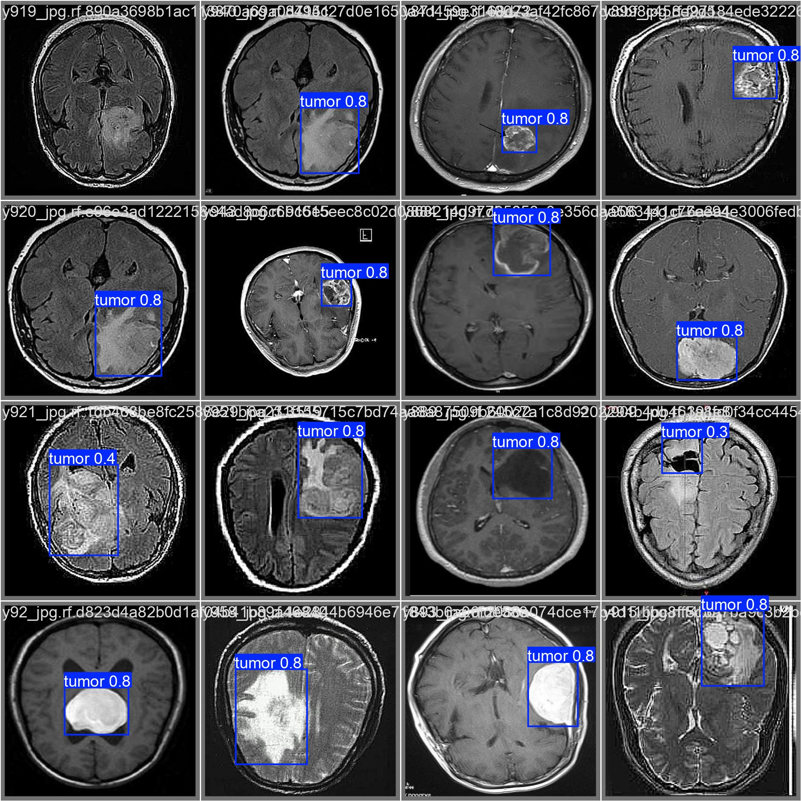

# YOLOv11 Brain Tumor Detection

Fine-tuning of **YOLO11** (Ultralytics) on a Roboflow Universe dataset to detect brain tumors on MRI/CT scan images.

This project was developed as part of the Deep Learning module at École Polytechnique de Thiès (DIC2, 2024-2025), under the supervision of Pr. Diop.

This is a personal/academic project built for portfolio purposes. It is **not** a validated medical tool — see [Limitations](#limitations) below.

## Dataset & attribution

The dataset used for training is **not my own** — all credit goes to its original authors:

- Workspace: [`selencakmak`](https://universe.roboflow.com/selencakmak) on Roboflow Universe
- Project: [`tumor-dj2a1`](https://universe.roboflow.com/selencakmak/tumor-dj2a1)

I only performed transfer learning on top of this dataset; I did not create or label it.

## Methodology

- Base model: **YOLO11n** (Ultralytics), pretrained weights
- Approach: transfer learning / fine-tuning on the Roboflow dataset above
- Training config: **15 epochs**, image size **640**
- Framework: [Ultralytics](https://docs.ultralytics.com/) YOLO CLI (`yolo task=detect mode=train ...`)

## Results

Evaluated on the validation split:

| Metric    | Value |
|-----------|-------|
| Precision | 0.969 |
| Recall    | 0.909 |
| mAP50     | 0.956 |
| mAP50-95  | 0.732 |

The gap between **mAP50** (0.956) and **mAP50-95** (0.732) shows that the model is very good at roughly localizing tumors (high overlap at a loose IoU threshold) but noticeably less precise when the predicted bounding box has to tightly match the ground-truth box across stricter IoU thresholds. In other words: it reliably finds *that* there is a tumor and roughly *where*, but the exact box boundaries are less consistently precise.


*Example predictions from the fine-tuned model on validation images*

## Limitations

- Trained for only **15 epochs** — not a fully converged, production-grade model.
- Dataset is of **modest size**, which limits generalization to images from other scanners, protocols, or populations.
- **No clinical validation** was performed. This project is for educational/portfolio purposes only and must not be used for actual medical diagnosis or decision-making.

## Installation

```bash
git clone https://github.com/ngone881/yolov11-brain-tumor-detection.git
cd yolov11-brain-tumor-detection
pip install -r requirements.txt
```

## Setting up your Roboflow API key

This project reads your Roboflow API key from an environment variable instead of hardcoding it.

1. Copy the example env file:
   ```bash
   cp .env.example .env
   ```
2. Edit `.env` and set your own key:
   ```
   ROBOFLOW_API_KEY=your_roboflow_api_key_here
   ```
3. Export it in your shell (or load it with `python-dotenv`) before running the notebook, e.g.:
   ```bash
   export ROBOFLOW_API_KEY=your_roboflow_api_key_here
   ```

You can get a free API key from your [Roboflow account settings](https://app.roboflow.com/settings/api).

## Reproducing the training

The notebook `tumorDetection.ipynb` was originally run on **Google Colab with a GPU** (Tesla T4). To reproduce:

1. Open `tumorDetection.ipynb` in Colab (or any environment with GPU access).
2. Install dependencies (first cells handle `ultralytics` and `roboflow`).
3. Set the `ROBOFLOW_API_KEY` environment variable (see above).
4. Run the cells in order — the dataset is downloaded from Roboflow, then YOLO11n is fine-tuned for 15 epochs at image size 640.
5. Training artifacts (weights, plots, validation results) are saved under `runs/` locally, and are not included in this repo (see `.gitignore`).

## Project structure

```
.
├── tumorDetection.ipynb   # Training/fine-tuning notebook
├── requirements.txt       # Python dependencies
├── .env.example           # Template for required environment variables
├── assets/                # Images used in this README
├── .gitignore
└── README.md
```

## References & Acknowledgments

- [Ultralytics YOLO11 documentation](https://docs.ultralytics.com/) — training/inference framework used
- [Roboflow Notebooks — train-yolo11-object-detection-on-custom-dataset.ipynb](https://github.com/roboflow/notebooks/blob/main/notebooks/train-yolo11-object-detection-on-custom-dataset.ipynb) — base notebook template this project builds on
- Dataset: ["tumor-dj2a1"](https://universe.roboflow.com/selencakmak/tumor-dj2a1) by Roboflow Universe workspace `selencakmak` (see Dataset & Attribution above)

## Author

**Ngoné Ndiaye** — Data Engineering student (Master DataScale, Université Paris-Saclay)
- GitHub: [@ngone881](https://github.com/ngone881)
- LinkedIn: [Ngoné Ndiaye](https://www.linkedin.com/in/ngoné-ndiaye-50aa0526b/)
